# Paper Results Figures

中文 · [English](README.md)

调用 `$paper-results-figures`，提供结果数据并说明比较需求，即可生成可复现的论文图。可以选择下面的预览并复制简短 Prompt，也可以让 Agent 选择适合的数据图形。支持检查并适配 CSV、TSV 和 XLSX；工作簿有多个相关工作表时，请指定要使用的工作表。

```text
使用 $paper-results-figures 比较 INPUT_DATA_PATH 中的不同方法。
每个 observation_id 是独立的观测单位，不同方法之间按该 ID 配对。
score 是 [0,1] 范围的无量纲分数，越高越好，突出显示 Ours。
使用纵向小提琴图，显示原始散点，色板 rainbow-transparent。
将结果保存到 OUTPUT_PARENT。
```

替换输入路径和输出文件夹。如果数据本身无法明确说明，请给出指标含义、观测单位、配对关系和改善方向。使用图库 Prompt 时，可以直接提供附带的 CSV，也可以换成自己的结果数据。Agent 会完成明确的列映射，创建最小绘图请求，检查图片并导出结果。

## 目录

- [将图库 Prompt 换成自己的数据](#将图库-prompt-换成自己的数据)
- [支持的图形](#支持的图形)
- [外观与输出](#外观与输出)
- [合成数据预览](#合成数据预览)
- [配对观测](#配对观测)
- [单指标多方法](#单指标多方法)
- [多指标多方法](#多指标多方法)
- [分组分布](#分组分布)
- [断轴箱线图](#断轴箱线图)
- [趋势比较](#趋势比较)
- [雷达图](#雷达图)
- [分组环形热图与小提琴图](#分组环形热图与小提琴图)
- [色板](#色板)
- [固定色板参考](#固定色板参考)
- [相同数据的不同色板](#相同数据的不同色板)
- [色板顺序](#色板顺序)
- [文件组织](#文件组织)
- [扩展图形](#扩展图形)

## 将图库 Prompt 换成自己的数据

每张预览都链接到一段可复制的提示词，统一分为两部分。使用随附合成 CSV 时，只改 `INPUT_DATA_PATH` 和 `OUTPUT_PARENT`；使用自己的 CSV、TSV 或 XLSX 时，修改 **DATA SETTINGS（数据设置）** 中的值，保留 **FIGURE SETTINGS（图形设置）** 即可沿用展示图的布局与配色。

| 数据设置中的项目 | 换成自己的数据时修改什么 |
| --- | --- |
| Input file / output parent | 输入文件和输出目录；XLSX 必要时补充工作表名 |
| Column mapping | 将示例列名换成自己的表头；明确无歧义的映射也可填 `auto` 让 Agent 识别 |
| Metric definitions | 指标名称、单位、有科学依据的取值域和改善方向；没有已知取值域时填写“no established domain” |
| Sampling / pairing / input meaning | 每行或每个 ID 代表什么、观测是否独立、方法间是否配对、数值是原始观测还是汇总值 |
| Focal / reference method | 自己的方法和参考方法在表中的实际名称；不需要时填 `none` |
| Test / order / selected IDs / omitted interval | 检查该图包含的项目：检验假设、指标或类别顺序、指定标记的观测、断轴区间 |
| Axis labels | 自己的科学标签及单位 |

示例填写的内容只描述随附的虚构数据。Agent 可以识别表头，但独立性、配对关系、改善方向和检验假设需要科学说明；取值域也不等于数据的最小值与最大值。Agent 会检查图形适用性，并在分析依赖的信息不明确时询问。字体、画布、间距和图例适配使用 Skill 默认设置。

## 支持的图形

| 科学比较 | 图形形式 | 图形指南（英文） |
| --- | --- | --- |
| 相同观测上的两个方法 | 配对散点图，可选配色、点大小与边际分布 | [配对散点图](references/paired-comparison-scatter.md) |
| 单指标多方法 | 横向或纵向柱形、箱线、小提琴和均值线 | [单指标比较](references/multi-comparison.md) |
| 多指标多方法 | 独立面板、双轴、共轴均值线和分组分布 | [多指标比较](references/multi-metric-comparison.md) |
| 随连续变量或类别的变化 | 回归拟合和分类趋势 | [趋势图](references/trend-comparsion.md) |
| 多轴指标轮廓 | 基于明确科学取值域的雷达图 | [雷达图](references/radar-comparison.md) |
| 组内条目的配对方法比较 | 环形热图，可选同批配对条目的小提琴图 | [分组环形热图](references/grouped-circular-heatmap.md) |

`references/` 中的每份图形指南集中说明该类型的数据要求、可选设置、默认外观和统计假设。可复制的 Prompt 与预览见下方图库。

分布与配对差值需要原始观测；汇总值无法还原重复观测或不确定性。共轴指标必须具有相同的已知单位和取值域，雷达图的缩放范围也须有科学依据。按需显示的双轴相关系数使用各方法的均值配对计算，不混合所有原始行。

## 外观与输出

所有文字均使用真实 Arial 字体。默认设置处理论文尺寸、可读刻度、文字适配和安全图例位置。纵向方法比较中，指定突出的方法放在最左侧；横向比较中放在最下方。明确的科学排序优先。可从下方固定色板参考中选择配色；各类图形的专用设置见对应图形指南。

每张图在输出目录中有独立文件夹，包含矢量 PDF、可编辑 SVG、600 dpi PNG、最终配置、绘图数据、统计记录和 R 会话记录。保留配置及输入适配步骤即可复现。修改同一张图时沿用其文件夹，并保持科学数值不变。

## 合成数据预览

每张预览都有独立文件夹，包含可直接使用的 Prompt 和固定 CSV 链接。分数示例中的 `Ours` 表现最好，较弱方法使差异更直观。相关图形和色板重复使用相同输入，Prompt 无须用户自行生成数据。同行展示框一致；常规图按高度、雷达图按实际圆径对齐。部分紧凑图采用更大预览，完整图片保持原始比例，不拉伸、不裁切。

### 配对观测

<table><tr>
<td align="center" width="450"><a href="examples/paired-comparison-scatter/prompt.md">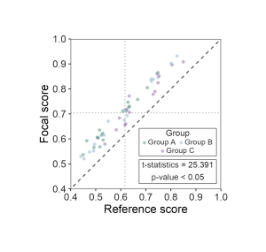</a><br><strong>分类配色的配对散点图</strong><br><code>muted-green-blue-purple</code><br><a href="examples/paired-comparison-scatter/prompt.md">Prompt 与 CSV</a> · <a href="examples/paired-comparison-scatter/preview.png">实际导出</a></td>
<td align="center" width="450"><a href="examples/paired-comparison-scatter-continuous/prompt.md">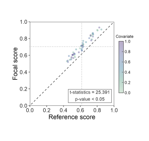</a><br><strong>连续数值配色的配对散点图</strong><br><code>muted-green-blue-purple</code><br><a href="examples/paired-comparison-scatter-continuous/prompt.md">Prompt 与 CSV</a> · <a href="examples/paired-comparison-scatter-continuous/preview.png">实际导出</a></td>
</tr></table>

<table><tr>
<td align="center" width="450"><a href="examples/paired-comparison-scatter-size-stars/prompt.md">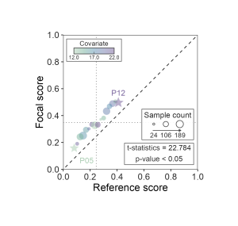</a><br><strong>点大小与指定星形标记</strong><br><code>muted-green-blue-purple</code><br><a href="examples/paired-comparison-scatter-size-stars/prompt.md">Prompt 与 CSV</a> · <a href="examples/paired-comparison-scatter-size-stars/preview.png">实际导出</a></td>
<td align="center" width="450"><a href="examples/paired-comparison-scatter-marginals/prompt.md">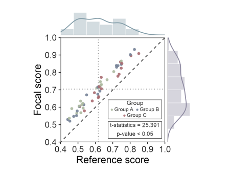</a><br><strong>边际直方图与密度曲线</strong><br><code>rainbow-transparent</code><br><a href="examples/paired-comparison-scatter-marginals/prompt.md">Prompt 与 CSV</a> · <a href="examples/paired-comparison-scatter-marginals/preview.png">实际导出</a></td>
</tr></table>

### 单指标多方法

<table><tr>
<td align="center" width="300"><a href="examples/multi-comparison/prompt.md">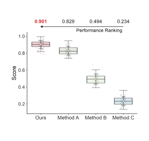</a><br><strong>箱线图、散点与标准差</strong><br><code>rainbow-transparent</code><br><a href="examples/multi-comparison/prompt.md">Prompt 与 CSV</a> · <a href="examples/multi-comparison/preview.png">实际导出</a></td>
<td align="center" width="300"><a href="examples/multi-comparison-violin/prompt.md"></a><br><strong>小提琴图、散点与标准差</strong><br><code>blue-pink-purple-peach-transparent</code><br><a href="examples/multi-comparison-violin/prompt.md">Prompt 与 CSV</a> · <a href="examples/multi-comparison-violin/preview.png">实际导出</a></td>
<td align="center" width="300"><a href="examples/multi-comparison-bar-horizontal/prompt.md">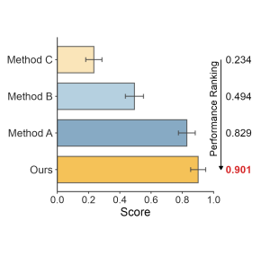</a><br><strong>横向均值柱形图</strong><br><code>blue-yellow</code><br><a href="examples/multi-comparison-bar-horizontal/prompt.md">Prompt 与 CSV</a> · <a href="examples/multi-comparison-bar-horizontal/preview.png">实际导出</a></td>
</tr></table>

<table><tr>
<td align="center" width="450"><a href="examples/multi-comparison-reference-line/prompt.md">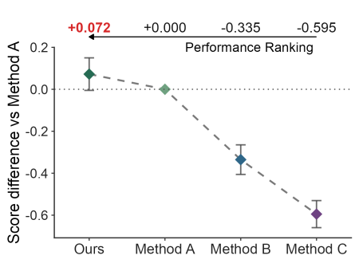</a><br><strong>配对参考差值</strong><br><code>muted-green-blue-purple-transparent</code><br><a href="examples/multi-comparison-reference-line/prompt.md">Prompt 与 CSV</a> · <a href="examples/multi-comparison-reference-line/preview.png">实际导出</a></td>
<td align="center" width="450"><a href="examples/multi-comparison-four-column/prompt.md">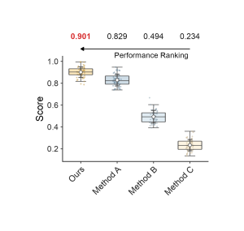</a><br><strong>四栏论文尺寸</strong><br><code>blue-yellow-transparent</code><br><a href="examples/multi-comparison-four-column/prompt.md">Prompt 与 CSV</a> · <a href="examples/multi-comparison-four-column/preview.png">实际导出</a></td>
</tr></table>

<table><tr>
<td align="center" width="300"><a href="examples/multi-comparison-significance/prompt.md">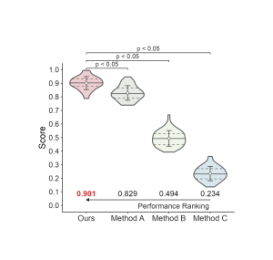</a><br><strong>纵向显著性括号</strong><br><code>rainbow-transparent</code><br><a href="examples/multi-comparison-significance/prompt.md">Prompt 与 CSV</a> · <a href="examples/multi-comparison-significance/preview.png">实际导出</a></td>
<td align="center" width="300"><a href="examples/multi-comparison-significance-horizontal/prompt.md">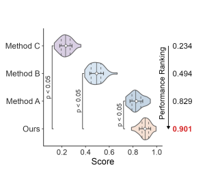</a><br><strong>横向显著性括号</strong><br><code>blue-pink-purple-peach-transparent</code><br><a href="examples/multi-comparison-significance-horizontal/prompt.md">Prompt 与 CSV</a> · <a href="examples/multi-comparison-significance-horizontal/preview.png">实际导出</a></td>
</tr></table>

单指标比较可选添加数值参考线，例如 `reference_lines: [{"value": 0.05, "label": "Baseline = 0.05"}]`。默认沿数值轴绘制红色紧凑虚线（`linetype: "42"`，实线段与空档长度比例为 2:1），可配经测量的外部 Arial 标签，并配置颜色、线型以及以毫米计的线宽和文字大小。参考值纳入显示轴范围，原始观测和统计汇总保持不变。 纵向参考线标签还会按原字号为旋转后的均值标注预留经测量的顶部边界。横纵方向和连续轴的使用要求见[单指标指南](references/multi-comparison.md#optional-numeric-reference-lines)。

### 多指标多方法

<table><tr>
<td align="center" width="300"><a href="examples/multi-metric-shared-rows/prompt.md">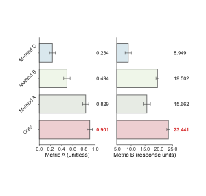</a><br><strong>并列柱形图，外侧数值</strong><br><code>rainbow-transparent</code><br><a href="examples/multi-metric-shared-rows/prompt.md">Prompt 与 CSV</a> · <a href="examples/multi-metric-shared-rows/preview.png">实际导出</a></td>
<td align="center" width="300"><a href="examples/multi-metric-shared-rows-inside/prompt.md">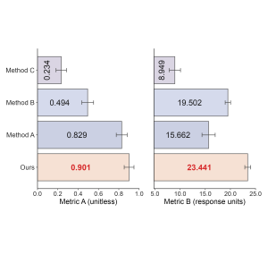</a><br><strong>并列柱形图，内部数值</strong><br><code>blue-pink-purple-peach-transparent</code><br><a href="examples/multi-metric-shared-rows-inside/prompt.md">Prompt 与 CSV</a> · <a href="examples/multi-metric-shared-rows-inside/preview.png">实际导出</a></td>
<td align="center" width="300"><a href="examples/multi-metric-shared-rows-no-sd/prompt.md"></a><br><strong>并列柱形图，不显示标准差</strong><br><code>blue-yellow-transparent</code><br><a href="examples/multi-metric-shared-rows-no-sd/prompt.md">Prompt 与 CSV</a> · <a href="examples/multi-metric-shared-rows-no-sd/preview.png">实际导出</a></td>
</tr></table>

<table><tr>
<td align="center" width="300"><a href="examples/multi-metric-stacked-bars/prompt.md"></a><br><strong>纵向排列的柱形面板</strong><br><code>muted-green-blue-purple-transparent</code><br><a href="examples/multi-metric-stacked-bars/prompt.md">Prompt 与 CSV</a> · <a href="examples/multi-metric-stacked-bars/preview.png">实际导出</a></td>
<td align="center" width="300"><a href="examples/multi-metric-shared-axis/prompt.md">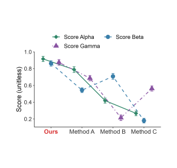</a><br><strong>同一数值轴上的多指标均值线</strong><br><code>muted-green-blue-purple-transparent</code><br><a href="examples/multi-metric-shared-axis/prompt.md">Prompt 与 CSV</a> · <a href="examples/multi-metric-shared-axis/preview.png">实际导出</a></td>
<td align="center" width="300"><a href="examples/multi-metric-shared-axis-bars/prompt.md">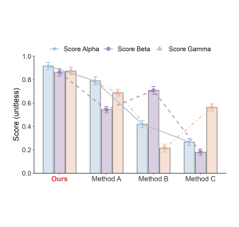</a><br><strong>均值线与图标下方的柱形</strong><br><code>blue-pink-purple-peach-transparent</code><br><a href="examples/multi-metric-shared-axis-bars/prompt.md">Prompt 与 CSV</a> · <a href="examples/multi-metric-shared-axis-bars/preview.png">实际导出</a></td>
</tr></table>

<table><tr>
<td align="center" width="300"><a href="examples/multi-metric-comparison-dual-axis/prompt.md">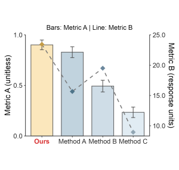</a><br><strong>双轴，按方法配色</strong><br><code>blue-yellow-transparent</code><br><a href="examples/multi-metric-comparison-dual-axis/prompt.md">Prompt 与 CSV</a> · <a href="examples/multi-metric-comparison-dual-axis/preview.png">实际导出</a></td>
<td align="center" width="300"><a href="examples/multi-metric-comparison-dual-axis-by-metric/prompt.md">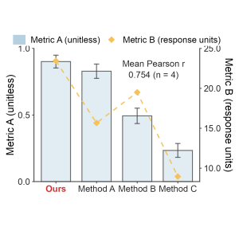</a><br><strong>双轴，按指标配色及均值相关系数</strong><br><code>blue-yellow-transparent</code><br><a href="examples/multi-metric-comparison-dual-axis-by-metric/prompt.md">Prompt 与 CSV</a> · <a href="examples/multi-metric-comparison-dual-axis-by-metric/preview.png">实际导出</a></td>
</tr></table>

### 分组分布

<table><tr>
<td align="center" width="300"><a href="examples/grouped-distributions-bar-vertical/prompt.md">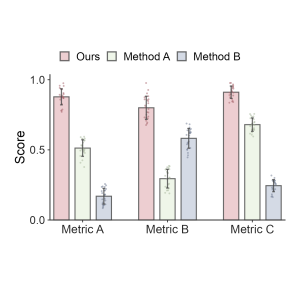</a><br><strong>纵向分组柱形</strong><br><code>rainbow-transparent</code><br><a href="examples/grouped-distributions-bar-vertical/prompt.md">Prompt 与 CSV</a> · <a href="examples/grouped-distributions-bar-vertical/preview.png">实际导出</a></td>
<td align="center" width="300"><a href="examples/grouped-distributions-bar-horizontal/prompt.md">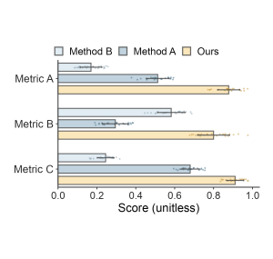</a><br><strong>横向分组柱形</strong><br><code>blue-yellow-transparent</code><br><a href="examples/grouped-distributions-bar-horizontal/prompt.md">Prompt 与 CSV</a> · <a href="examples/grouped-distributions-bar-horizontal/preview.png">实际导出</a></td>
<td align="center" width="300"><a href="examples/grouped-distributions-box-vertical/prompt.md">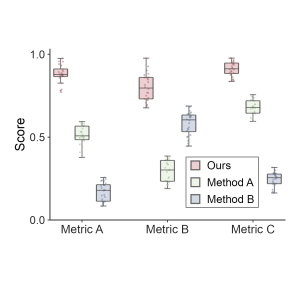</a><br><strong>纵向分组箱线图</strong><br><code>rainbow-transparent</code><br><a href="examples/grouped-distributions-box-vertical/prompt.md">Prompt 与 CSV</a> · <a href="examples/grouped-distributions-box-vertical/preview.png">实际导出</a></td>
</tr></table>

<table><tr>
<td align="center" width="300"><a href="examples/grouped-distributions-box-horizontal/prompt.md">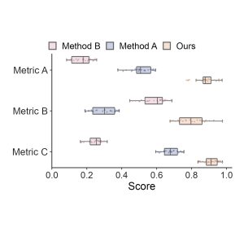</a><br><strong>横向分组箱线图</strong><br><code>blue-pink-purple-peach-transparent</code><br><a href="examples/grouped-distributions-box-horizontal/prompt.md">Prompt 与 CSV</a> · <a href="examples/grouped-distributions-box-horizontal/preview.png">实际导出</a></td>
<td align="center" width="300"><a href="examples/grouped-distributions-violin-vertical/prompt.md">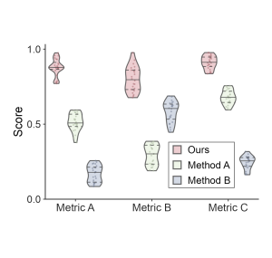</a><br><strong>纵向分组小提琴图</strong><br><code>rainbow-transparent</code><br><a href="examples/grouped-distributions-violin-vertical/prompt.md">Prompt 与 CSV</a> · <a href="examples/grouped-distributions-violin-vertical/preview.png">实际导出</a></td>
</tr></table>

<table><tr>
<td align="center" width="300"><a href="examples/grouped-distributions-violin-horizontal/prompt.md">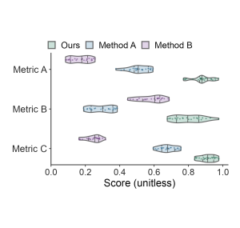</a><br><strong>横向分组小提琴图</strong><br><code>muted-green-blue-purple-transparent</code><br><a href="examples/grouped-distributions-violin-horizontal/prompt.md">Prompt 与 CSV</a> · <a href="examples/grouped-distributions-violin-horizontal/preview.png">实际导出</a></td>
<td align="center" width="300"><a href="examples/grouped-distributions-legend-space/prompt.md">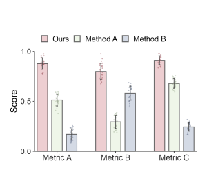</a><br><strong>完整范围的分组柱形图</strong><br><code>rainbow-transparent</code><br><a href="examples/grouped-distributions-legend-space/prompt.md">Prompt 与 CSV</a> · <a href="examples/grouped-distributions-legend-space/preview.png">实际导出</a></td>
</tr></table>

### 断轴箱线图

<table><tr>
<td align="center" width="450"><a href="examples/broken-box-vertical/prompt.md">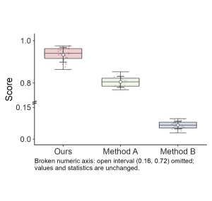</a><br><strong>纵向断轴箱线图</strong><br><code>rainbow-transparent</code><br><a href="examples/broken-box-vertical/prompt.md">Prompt 与 CSV</a> · <a href="examples/broken-box-vertical/preview.png">实际导出</a></td>
<td align="center" width="450"><a href="examples/broken-box-horizontal/prompt.md">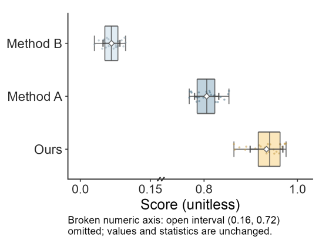</a><br><strong>横向断轴箱线图</strong><br><code>blue-yellow-transparent</code><br><a href="examples/broken-box-horizontal/prompt.md">Prompt 与 CSV</a> · <a href="examples/broken-box-horizontal/preview.png">实际导出</a></td>
</tr></table>

### 趋势比较

四方法趋势图例在单行放不下时，每行显示两个方法。

<table><tr>
<td align="center" width="300"><a href="examples/trend-two-models/prompt.md">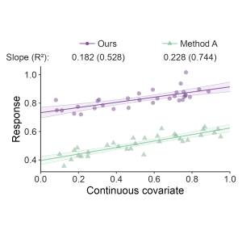</a><br><strong>双方法线性趋势</strong><br><code>muted-green-blue-purple</code><br><a href="examples/trend-two-models/prompt.md">Prompt 与 CSV</a> · <a href="examples/trend-two-models/preview.png">实际导出</a></td>
<td align="center" width="300"><a href="examples/trend-polynomial/prompt.md">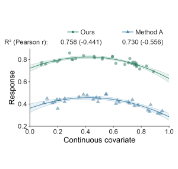</a><br><strong>多项式趋势</strong><br><code>muted-green-blue-purple</code><br><a href="examples/trend-polynomial/prompt.md">Prompt 与 CSV</a> · <a href="examples/trend-polynomial/preview.png">实际导出</a></td>
<td align="center" width="300"><a href="examples/trend-dual-metric/prompt.md">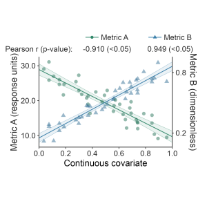</a><br><strong>双指标双轴趋势</strong><br><code>muted-green-blue-purple</code><br><a href="examples/trend-dual-metric/prompt.md">Prompt 与 CSV</a> · <a href="examples/trend-dual-metric/preview.png">实际导出</a></td>
</tr></table>

<table><tr>
<td align="center" width="300"><a href="examples/trend-multi-model/prompt.md">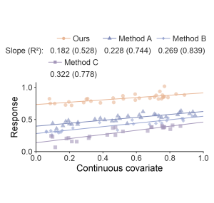</a><br><strong>四方法线性趋势</strong><br><code>blue-pink-purple-peach-transparent</code><br><a href="examples/trend-multi-model/prompt.md">Prompt 与 CSV</a> · <a href="examples/trend-multi-model/preview.png">实际导出</a></td>
<td align="center" width="300"><a href="examples/trend-categorical-horizontal/prompt.md">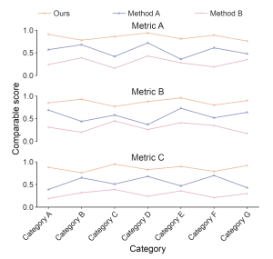</a><br><strong>横轴分类，三个指标</strong><br><code>blue-pink-purple-peach-transparent</code><br><a href="examples/trend-categorical-horizontal/prompt.md">Prompt 与 CSV</a> · <a href="examples/trend-categorical-horizontal/preview.png">实际导出</a></td>
<td align="center" width="300"><a href="examples/trend-categorical-vertical/prompt.md">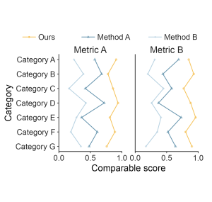</a><br><strong>纵轴分类，两个指标</strong><br><code>blue-yellow-transparent</code><br><a href="examples/trend-categorical-vertical/prompt.md">Prompt 与 CSV</a> · <a href="examples/trend-categorical-vertical/preview.png">实际导出</a></td>
</tr></table>

### 雷达图

<table><tr>
<td align="center" width="350"><a href="examples/radar-comparison/prompt.md">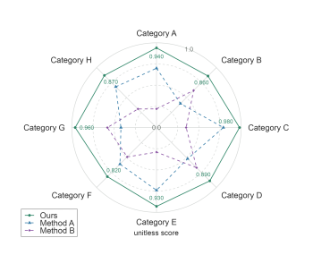</a><br><strong>雷达图：绿蓝紫</strong><br><code>muted-green-blue-purple</code><br><a href="examples/radar-comparison/prompt.md">Prompt 与 CSV</a> · <a href="examples/radar-comparison/preview.png">实际导出</a></td>
<td align="center" width="350"><a href="examples/radar-comparison-rainbow/prompt.md">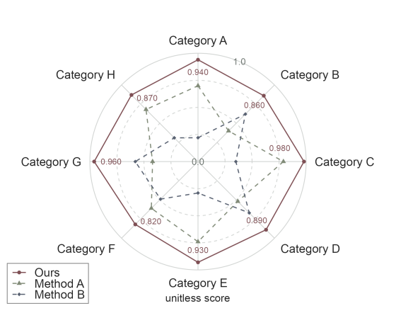</a><br><strong>雷达图：彩虹</strong><br><code>rainbow-transparent</code><br><a href="examples/radar-comparison-rainbow/prompt.md">Prompt 与 CSV</a> · <a href="examples/radar-comparison-rainbow/preview.png">实际导出</a></td>
</tr></table>

<table><tr>
<td align="center" width="300"><a href="examples/radar-comparison-pastel/prompt.md">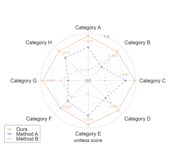</a><br><strong>雷达图：蓝粉紫桃</strong><br><code>blue-pink-purple-peach-transparent</code><br><a href="examples/radar-comparison-pastel/prompt.md">Prompt 与 CSV</a> · <a href="examples/radar-comparison-pastel/preview.png">实际导出</a></td>
<td align="center" width="300"><a href="examples/radar-comparison-bands/prompt.md">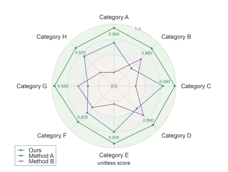</a><br><strong>雷达图：绿色渐变环带</strong><br><code>muted-green-blue-purple</code><br><a href="examples/radar-comparison-bands/prompt.md">Prompt 与 CSV</a> · <a href="examples/radar-comparison-bands/preview.png">实际导出</a></td>
</tr></table>

### 分组环形热图与小提琴图

<table><tr>
<td align="center" width="300"><a href="examples/grouped-circular-heatmap-blue-yellow/prompt.md"></a><br><strong>环形热图：蓝黄</strong><br><code>blue-yellow</code><br><a href="examples/grouped-circular-heatmap-blue-yellow/prompt.md">Prompt 与 CSV</a> · <a href="examples/grouped-circular-heatmap-blue-yellow/preview.png">实际导出</a></td>
<td align="center" width="300"><a href="examples/grouped-circular-heatmap-pastel/prompt.md"></a><br><strong>环形热图：蓝粉紫桃</strong><br><code>blue-pink-purple-peach</code><br><a href="examples/grouped-circular-heatmap-pastel/prompt.md">Prompt 与 CSV</a> · <a href="examples/grouped-circular-heatmap-pastel/preview.png">实际导出</a></td>
<td align="center" width="300"><a href="examples/grouped-circular-heatmap-one-group/prompt.md">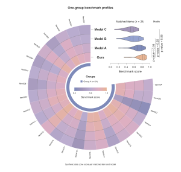</a><br><strong>环形热图：1 个组</strong><br><code>blue-pink-purple-peach</code><br><a href="examples/grouped-circular-heatmap-one-group/prompt.md">Prompt 与 CSV</a> · <a href="examples/grouped-circular-heatmap-one-group/preview.png">实际导出</a></td>
</tr></table>

<table><tr>
<td align="center" width="300"><a href="examples/grouped-circular-heatmap-three-groups/prompt.md">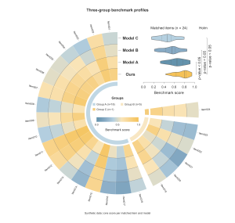</a><br><strong>环形热图：3 个不等大的组</strong><br><code>blue-yellow</code><br><a href="examples/grouped-circular-heatmap-three-groups/prompt.md">Prompt 与 CSV</a> · <a href="examples/grouped-circular-heatmap-three-groups/preview.png">实际导出</a></td>
<td align="center" width="300"><a href="examples/grouped-circular-heatmap-eight-groups/prompt.md"></a><br><strong>环形热图：8 个不等大的组</strong><br><code>blue-yellow</code><br><a href="examples/grouped-circular-heatmap-eight-groups/prompt.md">Prompt 与 CSV</a> · <a href="examples/grouped-circular-heatmap-eight-groups/preview.png">实际导出</a></td>
<td align="center" width="300"><a href="examples/grouped-circular-heatmap-twelve-groups/prompt.md">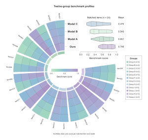</a><br><strong>环形热图：12 个小组</strong><br><code>muted-green-blue-purple-light</code><br><a href="examples/grouped-circular-heatmap-twelve-groups/prompt.md">Prompt 与 CSV</a> · <a href="examples/grouped-circular-heatmap-twelve-groups/preview.png">实际导出</a></td>
</tr></table>

## 色板

### 固定色板参考

色盘按 **11 个色系组织：6 个常用、5 个扩展**，同一色系的透明度、亮度和容量变化归为变体。优先从下表选择；既有预设名称继续支持，已保存的命名映射保留原颜色。[完整色系目录](references/palette-catalog.md) · [固定颜色规则](references/palette-contract.md)。

| 色系 | 推荐预设 | 适用情形 |
| --- | --- | --- |
| 淡绿 / 淡蓝 / 紫 / 桃色 | `pastel-green-blue-purple-peach` | 柔和的四模型分布图 |
| 绿 / 蓝 / 紫 | `muted-green-blue-purple` | 更强的色相区分，也可选更浅 RGB 变体 |
| 柔和彩虹 | `rainbow-transparent` | 多种方法的分类对比 |
| 蓝 / 黄 | `blue-yellow-transparent` | 两种主色相，可选不透明填充 |
| 蓝 / 粉 / 紫 / 桃色 | `blue-pink-purple-peach-transparent` | 四种协调色相 |
| 平衡多色 | `muted-balanced-twelve` | 六色核心与十二分类颜色扩展 |

绿／蓝／紫系列按已确定的展示顺序呈现绿 → 蓝 → 紫（横向方法对比从下向上读）。蓝黄系列在分类总数为偶数时，蓝黄各占一半，焦点方法也计入总数；环形图的协调分组配色遵循同一规则。蓝／粉／紫／桃色系列增强了蓝紫区分度，保留粉色、桃色和透明度。已保存的命名颜色映射优先。 [三色绘图 Prompt](examples/palette-three-colors/prompt.md) · [预览](examples/palette-three-colors/preview.png)。

<p align="center"><a href="examples/palettes/palette-families-overview.png">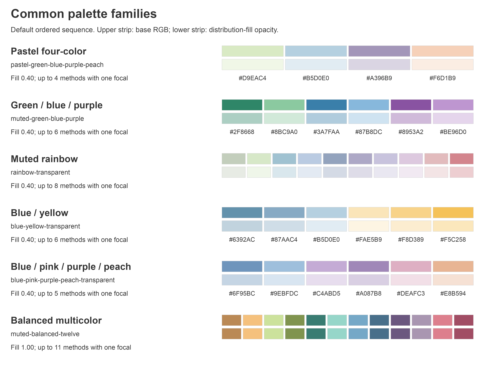</a></p>

当前保存的四颜色系：淡绿 `#D9EAC4`、淡蓝 `#B5D0E0`、紫 `#A396B9`、桃色 `#F6D1B9`，填充不透明度 0.40。

扩展目录保留柔和六色、参考六色、蓝绿配黄/珊瑚、黄绿配红及暖黄叶绿方案。相近 RGB 保留为变体；只有完全相同的颜色列表共用定义。

作图示例：[淡绿／淡蓝／紫／桃色小提琴图](examples/palette-pastel-green-blue-purple-peach/prompt.md)。

[当前四色参考](examples/palettes/palette-pastel-green-blue-purple-peach.png)

统一的 `warm-yellow-leaf-crisper` 色板同时包含中等深浅的分类颜色与浅色橙黄绿渐变，可用于连续色标或明确指定顺序的命名颜色映射；见[色板参考](examples/palettes/palette-warm-yellow-leaf-crisper.png)。

### 相同数据的不同色板

<table><tr>
<td align="center" width="300"><a href="examples/palette-muted-green-blue-purple/prompt.md">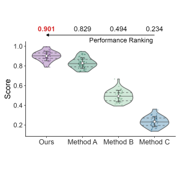</a><br><strong>Violin palette demonstration</strong><br><code>muted-green-blue-purple</code><br><a href="examples/palette-muted-green-blue-purple/prompt.md">Prompt 与 CSV</a> · <a href="examples/palette-muted-green-blue-purple/preview.png">实际导出</a></td>
<td align="center" width="300"><a href="examples/palette-muted-green-blue-purple-transparent/prompt.md">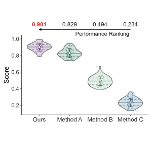</a><br><strong>Violin palette demonstration</strong><br><code>muted-green-blue-purple-transparent</code><br><a href="examples/palette-muted-green-blue-purple-transparent/prompt.md">Prompt 与 CSV</a> · <a href="examples/palette-muted-green-blue-purple-transparent/preview.png">实际导出</a></td>
<td align="center" width="300"><a href="examples/palette-rainbow/prompt.md">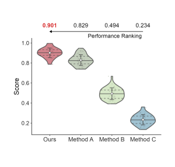</a><br><strong>Violin palette demonstration</strong><br><code>rainbow</code><br><a href="examples/palette-rainbow/prompt.md">Prompt 与 CSV</a> · <a href="examples/palette-rainbow/preview.png">实际导出</a></td>
</tr></table>

<table><tr>
<td align="center" width="300"><a href="examples/palette-rainbow-transparent/prompt.md">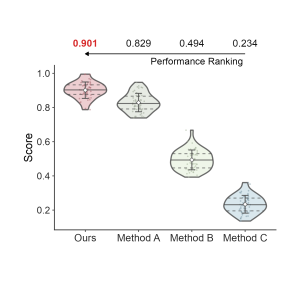</a><br><strong>Violin palette demonstration</strong><br><code>rainbow-transparent</code><br><a href="examples/palette-rainbow-transparent/prompt.md">Prompt 与 CSV</a> · <a href="examples/palette-rainbow-transparent/preview.png">实际导出</a></td>
<td align="center" width="300"><a href="examples/palette-blue-yellow/prompt.md">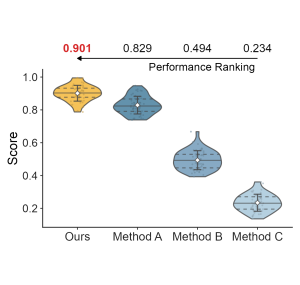</a><br><strong>Violin palette demonstration</strong><br><code>blue-yellow</code><br><a href="examples/palette-blue-yellow/prompt.md">Prompt 与 CSV</a> · <a href="examples/palette-blue-yellow/preview.png">实际导出</a></td>
<td align="center" width="300"><a href="examples/palette-blue-yellow-transparent/prompt.md">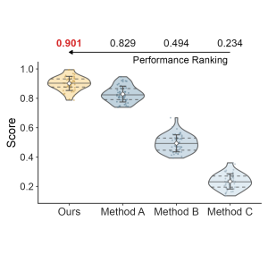</a><br><strong>Violin palette demonstration</strong><br><code>blue-yellow-transparent</code><br><a href="examples/palette-blue-yellow-transparent/prompt.md">Prompt 与 CSV</a> · <a href="examples/palette-blue-yellow-transparent/preview.png">实际导出</a></td>
</tr></table>

<table><tr>
<td align="center" width="300"><a href="examples/palette-blue-pink-purple-peach/prompt.md">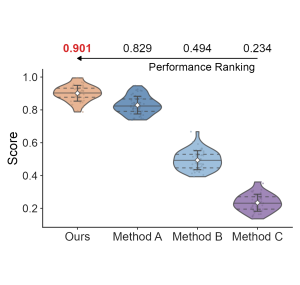</a><br><strong>Violin palette demonstration</strong><br><code>blue-pink-purple-peach</code><br><a href="examples/palette-blue-pink-purple-peach/prompt.md">Prompt 与 CSV</a> · <a href="examples/palette-blue-pink-purple-peach/preview.png">实际导出</a></td>
<td align="center" width="300"><a href="examples/palette-blue-pink-purple-peach-transparent/prompt.md">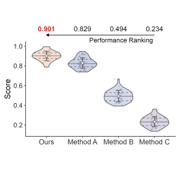</a><br><strong>Violin palette demonstration</strong><br><code>blue-pink-purple-peach-transparent</code><br><a href="examples/palette-blue-pink-purple-peach-transparent/prompt.md">Prompt 与 CSV</a> · <a href="examples/palette-blue-pink-purple-peach-transparent/preview.png">实际导出</a></td>
</tr></table>

### 色板顺序

颜色顺序与透明度独立：`palette_order: ordered` 为默认值，将相近颜色排在邻近位置；`palette_order: shuffled` 使用 `palette_seed: 42`，对同一组已选颜色进行可重复的乱序。种子可设为其他非负整数。此选项不改变模型/数据的展示顺序或连续渐变，各色系的焦点和蓝黄数量平衡规则仍然适用。显式颜色映射（包括保存后的完整配置中的映射）优先；希望重新自动分配时，先移除这些映射。乱序偶尔可能与顺序结果一致。

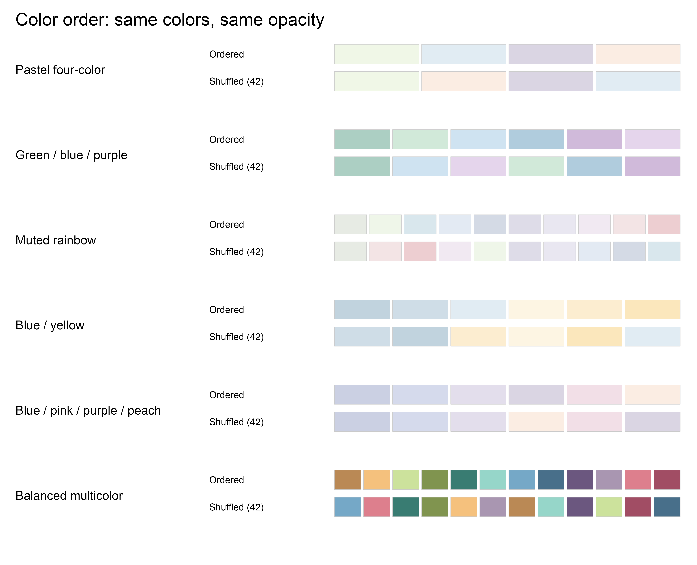

## 文件组织

`examples/<figure-id>/prompt.md` 是面向用户的使用示例，`request.json` 在适用时提供最小配置结构，`preview.png` 是未经修改的科学导出，`preview-card.svg` 将其等比例放入统一尺寸的展示框。共享合成输入集中放在 `examples/data/`。执行时从 `SKILL.md` 开始，再阅读共享样式及所选图形、色板的契约。`scripts/` 存放可复用渲染器，`palettes/` 存放固定颜色定义。本指南和图库用于选择、改写示例，不是执行时的必读内容。

## 扩展图形

若需要其他表达形式，请提供结果数据和参考图，并说明需要保留哪些视觉元素。Agent 会检查数据的科学含义，再选择或调整可复用的布局。

画布尺寸、字体和通用外观见[共享样式指南](references/style-guide.md)，各布局的具体设置集中在对应图形指南中。已保存的显式设置优先，既有示例预览保留其已验收的导出尺寸。
